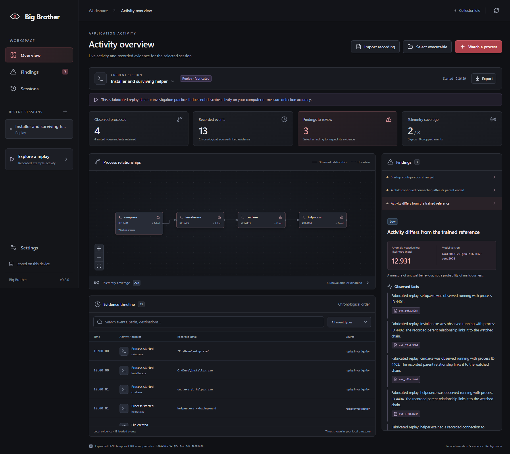

# Big Brother

Windows desktop process observation, behavioural anomaly scoring and evidence investigation. Select a process or executable, watch its descendants, inspect a chronological timeline and review findings linked to recorded events. An absence of findings does not establish safety.



## Run on Windows

The per-user installer and portable executable are built into `release/`. Neither requires Python, Node, Docker, a paid API key or an external language model. See [Windows setup](docs/windows-setup.md) for package paths and optional richer telemetry.

Selecting a file does not execute it. **Launch and watch** is the explicit execution action. Watching an existing process labels earlier ancestry as incomplete. Closing the window hides the app in the tray; **Stop collection and exit** stops this app. Any separately installed Sysmon service remains active.

Use **Explore a replay → Investigation → Open replay** to inspect four processes, thirteen retained events and three findings. Replay data is fabricated, never executed and excluded from model evaluation. The active trained model scores its supported events; startup changes and surviving children are separately labelled transparent rules.

## Models actually trained

Version 0.2.0 activates a larger temporal GRU selected from four neural runs and two histogram baselines. Expanded LANL 2015 prefixes contain 17,510,711 complete process/DNS/network records. After excluding all v1 timestamps and separating hosts/times, training uses 90,235 windows and 721,880 next-event targets, about nine times v1. A checked standard-library export runs the actual weights without PyTorch in the app.

| Same fresh test, 8,048 disjoint windows | Expanded baseline | Unchanged v1 | Active v2 |
|---|---:|---:|---:|
| Next-event loss, nats (lower is better) | 0.831453 | 0.603148 | 0.571488 |
| Perplexity | 2.296654 | 1.827863 | 1.770900 |
| Unlabelled windows above frozen threshold | 87 / 8,048 | 237 / 8,048 | 94 / 8,048 |

V2 reduces prediction loss by 5.25% relative to v1 on the same new holdout. These are predictive/anomaly results. Malware precision, recall, F1, false-positive rate and detection latency remain unmeasured. The model consumes process start/end, DNS and port categories; file, Registry, process-access, module and remote-thread evidence stays outside its inputs. See [model card](docs/model-card.md), [expanded experiment](docs/model-v2-experiments.md) and [saved results](training/results/v2/metrics.json). Historical v1 results and the `v0.1.0` tag are preserved.

## Recorded scenarios and harmless test applications

The [dataset catalog](training/catalog-v2.json) reviews sixteen relevant families. Actual pinned OTRF and EVTX lab logs supply 264 unique recordings and 986,382 normalized Windows events. They are held out from fitting. External prediction improves, but only 2.014% of their events fit this model's vocabulary. Scenario attack labels include mixed background activity and are not event-level malware ground truth.

**Import recording** reads bounded normalized JSON through a native file dialog, displays recorded coverage/provenance and never executes dataset commands. Separately labelled reference rules cite actual startup changes, surviving children, memory-capable access to `lsass.exe` and remote-thread events. The latter two follow [Microsoft access-rights documentation](https://learn.microsoft.com/en-us/windows/win32/procthread/process-security-and-access-rights) and [Sysmon event documentation](https://learn.microsoft.com/en-us/sysinternals/downloads/sysmon); legitimate tools can generate them.

Three [harmless simulator executables](docs/simulators-v2.md) exercise files in owned scratch folders, trusted child processes and loopback traffic. Live v2 tests produced no anomaly findings for these benign workloads, while the surviving-child reference retained valid citations. They test attribution and workflow, not malware accuracy. A separate [EMBER static-feature study](docs/static-pe-experiment.md) trains supervised research models from numeric features without downloading malware binaries; extractor parity is not established, so it is not a shipped executable scanner.

Official OpTC downloads were quota-blocked. An inspected transformed OpTC mirror was excluded from training because its conversion provenance was undocumented. LANL prefixes came from a public mirror whose publisher documents official-source acquisition; full-file equality to the registration-gated official originals was not independently verified. Dataset revision, prefix checksums and exclusions are recorded in the manifest.

## Development and reproducibility

From this repository in PowerShell:

```powershell
python -m venv .venv
.venv\Scripts\python.exe -m pip install -r requirements.txt --cache-dir .cache/pip
npm.cmd ci
npm.cmd run build:ui
npm.cmd start
```

For Vite development use `npm.cmd run dev`. `npm.cmd` avoids changing PowerShell's script-execution policy.

```powershell
# Build both Windows packages, with all caches/temp files on D:
powershell -ExecutionPolicy Bypass -File scripts/build.ps1

# Meaningful Windows and model checks
.venv\Scripts\python.exe -m pytest tests -q
npm.cmd run test:desktop
npm.cmd run test:gui
.venv\Scripts\python.exe -m backend.service --self-test --resources resources
.venv\Scripts\python.exe scripts/benchmark.py
```

Training dependencies are separate. Use `training/requirements.txt` and the CPU PyTorch index documented there. Follow [v2 reproduction](docs/model-v2-experiments.md) for a separate output directory; the trainer refuses to overwrite frozen results. The original `training/train.py` is historical and writes runtime weights, so reproduce v1 in a checkout of `v0.1.0`. Do not retune after observing final-test results.

## Documentation

- [Architecture and trust boundaries](docs/architecture.md)
- [Windows setup and dependency changes](docs/windows-setup.md)
- [Telemetry capability matrix](docs/telemetry.md)
- [Local data, retention and privacy](docs/privacy.md)
- [Optional approved local/remote commentary](docs/optional-llm.md)
- [Dependency licences](THIRD_PARTY_NOTICES.md)
- [Ordinary and investigation replay demo](docs/demo.md)
- [Private GitHub checkpoints and rollback](docs/version-history.md)
- [Expanded validation, package paths and exact commands](HANDOFF_V2.md)
- [Historical v0.1.0 handoff](HANDOFF.md)

Monitoring and deterministic explanations are local. The optional LLM CLI requires review of a redacted preview and approval of its exact hash; remote requests additionally require explicit opt-in. It never determines detections or executes tools.

Packages are unsigned. Live Sysmon ingestion requires an existing configured readable channel; native polling and fabricated replay were validated on this Windows machine. Rich live Sysmon collection remains unverified here. No autonomous killing, blocking, quarantine or deletion of watched programs is implemented.
