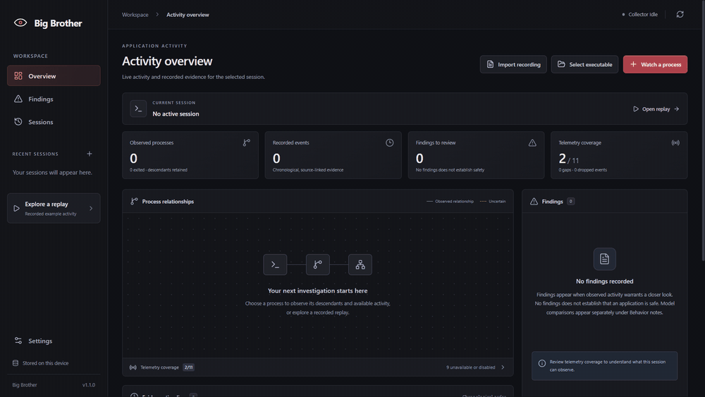
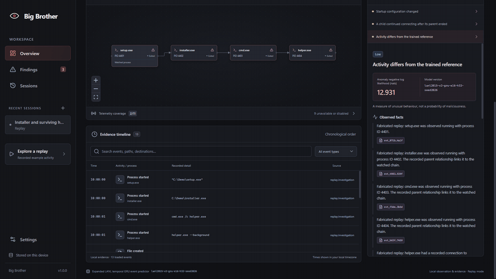

# Big Brother

**See what a Windows program is doing, follow its helper programs, and investigate recorded activity in one place.**

## Download v1.0.0

**[Download installer + portable together (ZIP)](https://github.com/jarvis0626/big-brother/releases/download/v1.0.0/Big-Brother-1.0.0-Windows-x64.zip)**

| Choose your download | How to use it |
| --- | --- |
| **[Installer — recommended](https://github.com/jarvis0626/big-brother/releases/download/v1.0.0/Big-Brother-1.0.0-x64-nsis.exe)** | Open it, follow setup, then start Big Brother from the Start menu. |
| **[Portable app](https://github.com/jarvis0626/big-brother/releases/download/v1.0.0/Big-Brother-1.0.0-x64-portable.exe)** | Put it in a writable folder and open it. No installation step. |
| **[Both in one ZIP](https://github.com/jarvis0626/big-brother/releases/download/v1.0.0/Big-Brother-1.0.0-Windows-x64.zip)** | Extract the ZIP and choose the `Installer` or `Portable` folder. You only need one. |

[Open the release page](https://github.com/jarvis0626/big-brother/releases/tag/v1.0.0) · [Download checksums](https://github.com/jarvis0626/big-brother/releases/download/v1.0.0/SHA256SUMS.txt)

Windows 11, 64-bit. **No Python, Node, Docker, API key or paid subscription needed.** This repository and its downloads are private: sign in to a GitHub account with repository access. The packages are unsigned, so Windows may display an unknown-publisher message.

## What can it do?

- **Watch a program and its helpers.** See which programs it starts and how they connect to one another.
- **Show a searchable activity timeline.** Inspect recorded starts, exits and connections. Extra file, Registry and DNS detail depends on the telemetry available on your computer.
- **Highlight activity worth reviewing.** The trained model flags unusual event sequences. Separately labelled reference rules explain patterns such as a helper continuing to connect after its parent closes.
- **Explain findings with evidence.** Read what was observed, possible explanations, missing information and suggested checks. Click an event reference to see the supporting record.
- **Keep investigations for later.** Reopen saved sessions, control history limits and export a local JSON report.
- **Explore safely with samples.** Built-in replays use clearly marked sample data. Import compatible recordings without running their recorded commands.

## See it in action

These GIFs show the actual desktop app using its built-in **fabricated sample replay**. No sample program or attack command is executed.

**Open the sample and explore a program's activity:**

**Follow a finding back to the evidence and export your investigation:**

## Your first five minutes

1. **Open the app.** Install the recommended download, or extract the ZIP and open the portable executable.
2. **Try the sample.** Choose **Explore a replay → Investigation → Open replay**. The boxes are programs, and the lines show which program started another.
3. **Read a finding.** Open **Findings**, select an item and click an event reference to inspect the exact recorded activity.
4. **Watch a real program.** Choose **Watch a process** and select a program that is already open. Earlier activity may be missing.
5. **Save your work.** Use **Export** for a local report, or return later through **Sessions**.

**Select executable** only chooses a file. **Launch and watch** starts that file. Watching an already-running process does not restart it.

The portable app keeps history in `BigBrother-data` beside its executable; keep that folder when moving it. The installed app uses your Windows user-data folder. Closing the window normally hides the app in the system tray; choose **Stop collection and exit** to quit.

[Full beginner guide](docs/quick-start.md) · [Sample walkthrough](docs/demo.md)

## Your data and what the results mean

Observation, scoring and ordinary explanations run locally. Reports are only saved where you choose, and can contain private paths, commands or destinations. Review them before sharing. **Settings** lets you change retention and inspect **Telemetry coverage**.

Basic program and connection observation works without extra services. Broader file, Registry and DNS evidence needs an already configured Microsoft Sysmon installation; Big Brother does not install or change that service automatically. [Advanced setup and coverage](docs/windows-setup.md).

A finding is a reason to investigate, not a malware verdict. A quiet findings list does not prove a program is safe. Big Brother does not block, quarantine or remove threats, and the shipped model's malware-detection accuracy has not been established. The separate static-file research classifier is not an executable scanner in this release.

## More information

- [Local data, retention and privacy](docs/privacy.md)
- [How collection and the app fit together](docs/architecture.md)
- [Model results and limitations](docs/model-card.md)
- [Development, training and reproducibility](docs/development.md)
- [Version history and rollback](docs/version-history.md)
- [Third-party notices](THIRD_PARTY_NOTICES.md)
- [v1.0.0 release notes](docs/releases/v1.0.0.md)

Earlier source versions and research results remain in Git history. v1.0.0 packages the existing frozen behavioral model with a beginner-friendly download and demonstration guide; its app version is separate from the model version.
