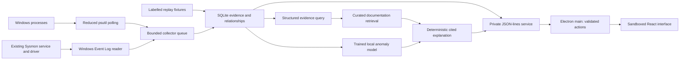

# Architecture

Big Brother observes selected applications, records evidence, reconstructs relationships and scores supported behavioural features. It is an investigation aid. An absence of findings cannot establish safety.

## Trust boundaries

Electron enables renderer sandboxing, context isolation and web security, disables Node integration, denies permissions and new windows, and blocks navigation away from the packaged page. The preload exposes only narrow methods. Main verifies the originating frame and validates allowed methods, fields and resource limits. Only main can show native file/save dialogs. Launch uses a path previously selected in that dialog and a separate explicit action. Main never constructs a shell command from renderer data.

The Python backend is a direct child process accessed through inherited stdin/stdout pipes. There is no listening HTTP/WebSocket endpoint or exposed local token. Stdout contains protocol messages only. Responses correlate with numeric request IDs; requests are bounded with timeouts and pending-request limits. Child failure is visible as a disconnected collector. Electron main exits the backend when the user exits. Independently installed Sysmon remains active.

The UI bundles local assets and its content-security policy restricts scripts to those assets. External documentation can only open in the user's browser via a curated HTTPS host allowlist. Telemetry text is rendered as text, never HTML or commands. A recorded command line is evidence; it is never evaluated.

## Observation and storage

Sysmon uses documented native Windows Event Log APIs and existing channel permissions. Its stable process GUIDs and source record IDs are preserved. Process polling uses PID plus process creation time and labels ancestry/coverage limits. Polling can miss processes between snapshots and network connections that disappear quickly. Selected session relationships and evidence are stored in SQLite, and later descendant evidence can remain associated after the root exits when reliable process relationships exist.

Queue bounds, batching, retention and session/event limits constrain resources. Deduplication uses source provenance. Event timestamps and ingestion times are distinct; ordering cannot be inferred solely from arrival. Monitoring gaps, source failure and skipped/dropped records are reported. Historical snapshots are limited in the UI to remain responsive; export includes available retained evidence.

## Detection and explanations

The trained model and feature schema are versioned resources. Model metadata is returned in every state; missing or incompatible models are visible and are never silently replaced with rules. Rules remain a transparent reference. Neural experiments and feature baseline results are saved under training/results and explained in the model card. Raw anomaly scores have no probability interpretation.

Explanation retrieval starts with observed session events and process relationships. The curated, versioned knowledge corpus supports keyword retrieval with authoritative source links. No held-out labels or resolved incident answers are included. Deterministic templates separate observations, possible interpretations, missing information and suggested checks. Observations cite retained event IDs. Fabricated replay demonstrates workflow and contributes no reported real-world accuracy.

## Distribution

PyInstaller freezes only Python runtime/inference dependencies. Electron builder includes it as a resource in both per-user NSIS installer and portable launcher. Training data, Torch, scikit-learn and developer tools are excluded from ordinary users' requirements. The portable launcher stores retained data alongside itself; the installed app uses the user's application-data directory. Build scripts set all caches and temporary build files to the project on D:.

The app does not perform autonomous remediation. It does not kill, block, quarantine, delete watched programs, disable Defender, or create persistence. Deleting a retained session removes the application's local records only.
